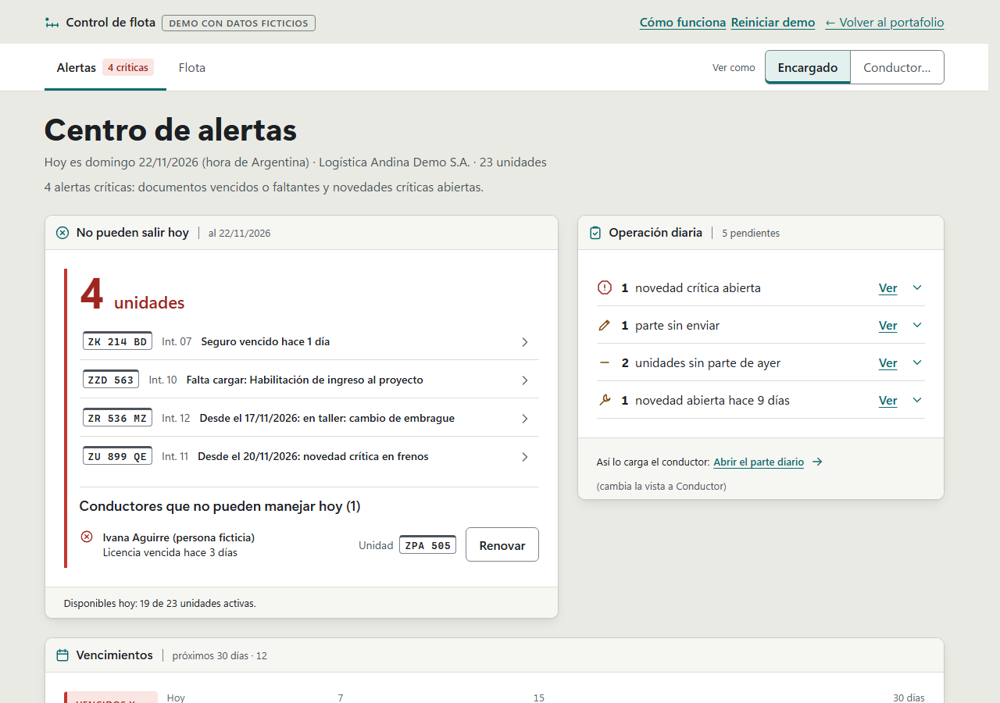

# Control de flota (demo)

Demo web que responde, en una pantalla, a dos preguntas: **¿qué unidades no pueden salir hoy? y ¿qué documentos vencen pronto?** Además, el conductor completa su parte diario desde el celular, en dos pasos.

Funciona entera en el navegador: sin servidor, sin cuenta y sin conexiones externas. Los datos son ficticios y quedan solo en el navegador de quien la abre. Parte del portafolio de Matías Ariel Ormeño.

<!-- URL de la demo en vivo: pendiente. Quitar este comentario al publicar. -->
**Demo en vivo:** todavía no está publicada. Cuando lo esté, el enlace va aquí.



*Centro de alertas (perfil Encargado, 1280 px): qué unidades no pueden salir hoy y por qué (seguro vencido, falta de habilitación, en taller, novedad crítica en frenos), qué conductora no puede manejar hoy (persona ficticia, licencia vencida hace 3 días) y los 6 pendientes de la operación diaria.*


*Revisión antes de salir (perfil Conductor, 360 px): el aviso de que la unidad no puede salir aparece antes de completar el parte; la barra inferior dice cuántos datos faltan para enviar.*
<!-- revisar A1/M2: la captura y su texto se rehacen cuando el programador termine (14 puntos; aviso por documentación) -->

## Cómo usarla

La barra «Ver como» cambia entre **Encargado** (perfil de entrada) y **Conductor**. Es una perspectiva, no un control de acceso. **Reiniciar demo** vuelve al estado inicial.

1. **Encargado.** Abra la demo: el centro de alertas muestra 4 unidades que no pueden salir y los vencimientos próximos.
2. **Renovar un seguro.** Pulse «Renovar» en el seguro vencido de ZK 214 BD: la alerta desaparece y la unidad deja de figurar en «No pueden salir».
3. **Una conductora sin licencia.** En «Conductores que no pueden manejar hoy» figura Ivana Aguirre, con la licencia vencida hace 3 días. En «Ver como», elija **Conductor** e Ivana Aguirre: en lugar de «Empezar la revisión», el inicio dice que no puede manejar hoy.
4. **Resolverlo.** Vuelva a Encargado y pulse «Renovar» en su fila: se carga una licencia vigente y sale de la lista. Como conductora, ahora sí puede empezar la revisión.
5. **Una falla grave.** Como conductora Gabriela Toledo (unidad ZI 442 TU), empiece la revisión, complete el kilometraje y los puntos, marque los frenos con una novedad crítica y envíe. La unidad queda fuera de servicio y aparece en «No pueden salir» del encargado.
6. **Una jornada normal.** Como conductor Bruno Juárez (unidad ZM 904 EB), envíe una revisión sin novedades: el inicio muestra «En uso». Pulse «Cerrar el parte», cargue kilometraje final y combustible: el parte queda en solo lectura.

Detalle de cada pantalla: [`docs/pantallas.md`](docs/pantallas.md).

## Las reglas, en una línea cada una

- **Vencimientos:** cada documento se clasifica como vencido, vence en 7, 15 o 30 días, o vigente; el renovado reemplaza al anterior.
- **Parte en dos pasos:** revisión antes de salir y cierre al volver, con borrador guardado mientras se escribe.
- **La licencia bloquea:** sin licencia vigente a la fecha del parte, el conductor no puede enviar la revisión.
- **La documentación de la unidad bloquea:** con el seguro u otro documento obligatorio vencido, la revisión no se envía. <!-- revisar A1/M2: decisión del 22/11/2026, la implementa el programador -->
- **Cerrar antes:** con un parte anterior sin cerrar, no se inicia otra revisión.
- **Hasta mañana:** con una novedad crítica hoy, la unidad no sale ese día, aunque se repare.
- **Aptitud:** «Puede salir» o «No puede salir» se calcula siempre; no se edita a mano.

Bordes de cada una: [`docs/limites.md`](docs/limites.md), sección 1. Casos de prueba: [`docs/diseno.md`](docs/diseno.md), sección 6.

## Cómo correrla localmente

Requiere Node 24 y npm 11.

```
npm install
npm run dev          # servidor de desarrollo
npm run build        # compilación en dist/
npm run servir       # sirve dist/ con las mismas cabeceras de seguridad que se usarán al publicar
```

`servir` requiere compilar antes.

## Cómo está hecha

- **Tecnología:** Vite 8, TypeScript 6 y Svelte 5, sin SvelteKit; la única dependencia de producción es `svelte`. Alternativas descartadas: [`docs/stack.md`](docs/stack.md).
- **Todo en el navegador:** datos en IndexedDB; si no se puede guardar, la demo sigue en memoria y avisa.
- **Reglas en TypeScript puro** (`src/lib/dominio`), probadas en Node y en tres zonas horarias.
- **Seguridad:** política de contenido estricta (`public/_headers`) con `connect-src 'none'`: la página no puede conectarse a ningún servidor.
- **Tamaño:** 118,73 KB de JavaScript comprimido con gzip (`npm run build`, 22/11/2026; tope fijado: 120 KB). <!-- cifra -->
- **Accesibilidad:** teclado, foco visible, controles de 44 px, modo claro y oscuro, desde 320 px de ancho.

## Cómo se usó la IA

- **Matías Ariel Ormeño** propuso la demo y definió el problema (el parte en papel se daña, tarda y no deja evidencia), el alcance y las reglas. Eligió entre las alternativas que propuso la IA; cada decisión figura con quién y cuándo en [`docs/diseno.md`](docs/diseno.md), sección 15, y [`docs/stack.md`](docs/stack.md), sección 9. Pidió pruebas destructivas en cada etapa.
- **La IA (Claude, de Anthropic) escribió el código, las pruebas y los documentos;** Matías no escribió el código a mano.
- **Método:** diseño primero, plan de pasos chicos ([`docs/plan.md`](docs/plan.md)) y lógica con pruebas primero (TDD).
- **Los roles de `docs/`** («programador», «QA», «revisor», «auditor») son agentes de IA dirigidos por Matías, no personas. Las revisiones por etapa también las hicieron agentes de IA, no terceras personas.
<!-- Falta (crítica R2): lo que Matías verificó en persona; la prueba en el celular está pendiente. Completar o quitar al publicar. -->
- **Rastro:** [`docs/registro.md`](docs/registro.md) y el historial de git.

## Cómo se verificó

Cifras del 22/11/2026: <!-- cifra -->

| Comprobación | Comando | Resultado |
| --- | --- | --- |
| Pruebas automáticas | `npm test` | 1.608 pruebas en 59 archivos, todas pasan <!-- cifra --> |
| Las mismas en tres zonas horarias | `npm run test:tz` | 1.608 pruebas en UTC, Asia/Tokio y América/Los Ángeles, todas pasan <!-- cifra --> |
| Tipos | `npm run check` | 0 errores y 0 avisos en 339 archivos <!-- cifra --> |
| Contraste de la paleta | `npm run contraste` | 182 mediciones, 0 fallan <!-- cifra --> |
| Búsqueda de lo prohibido | `npm run buscar` | Sin hallazgos (8 reglas, 198 archivos) <!-- cifra --> |
| Dependencias | `npm audit` | 0 vulnerabilidades |

También se recorrió la demo en un navegador (Playwright y axe-core, una vez, el 22/11/2026): sin violaciones de accesibilidad en 36 pantallas; no se puede reproducir con un comando. La integración continua (`ci.yml`) nunca corrió y no respalda ninguna cifra. Detalle y lo que no se probó: [`docs/limites.md`](docs/limites.md), sección 3.

## Límites conocidos

- **Sin login:** el perfil es una perspectiva; cualquiera puede «ser» el encargado.
- **Los datos viven en un solo navegador:** no se comparten y se pierden si se borran los datos del sitio.
- **Escribir y recargar en menos de 500 ms puede perder lo último:** el parte se guarda 500 ms después de la última tecla (y al salir del campo, al enviar o al irse de la pantalla).
- **Sin pruebas automáticas de las pantallas:** las pruebas cubren reglas, generador, persistencia y estado; las pantallas se verificaron a mano.
- **La habilitación de manejo interna del proyecto es opcional:** si un proyecto la pide, la demo no la exige para enviar la revisión. Se puede sumar después.

Límites menores: [`docs/limites.md`](docs/limites.md), sección 2.

## Datos ficticios

Todo es inventado y sale de una semilla fija (24 unidades, 16 conductores y 45 días de partes). El CUIT de la empresa se muestra siempre con la palabra «ficticio». Las patentes empiezan con `Z`; falta verificar qué series existen. Detalle: [`docs/limites.md`](docs/limites.md), sección 4.

## Origen

Iniciada el 18/11/2026 y escrita **desde cero** a partir de un enunciado propio. No usa código, datos ni capturas de terceros; solo reutiliza código propio y público del autor (la validación de CUIT de su demo «Lector de facturas»).

## Documentos

| Documento | Contenido |
| --- | --- |
| [`docs/pantallas.md`](docs/pantallas.md) | Qué permite cada pantalla. |
| [`docs/limites.md`](docs/limites.md) | Bordes de las reglas, límites menores y detalle de la verificación. |
| [`docs/diseno.md`](docs/diseno.md) | Problema, modelo de datos y reglas con su caso de prueba. |
| [`docs/diseno-ui.md`](docs/diseno-ui.md) | Dirección visual, componentes y accesibilidad. |
| [`docs/stack.md`](docs/stack.md) | Tecnología elegida, alternativas y criterio. |
| [`docs/plan.md`](docs/plan.md) | Pasos de implementación. |
| [`docs/registro.md`](docs/registro.md) | Qué se hizo, qué se verificó y qué quedó pendiente. |

## Licencia

[MIT](LICENSE).
