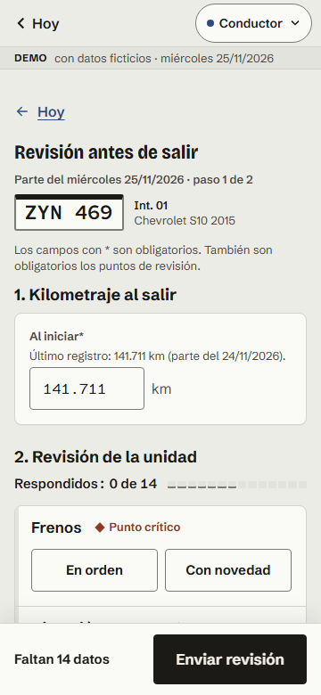

# Control de flota (demo)

Demo web que responde, en la pantalla de inicio, a dos preguntas: **¿qué unidades no están disponibles hoy? y ¿qué documentos vencen pronto?** Además, el conductor completa su parte diario desde el celular, en dos pasos.

Funciona entera en el navegador: sin servidor, sin cuenta y sin conexiones externas. Los datos son ficticios. Parte del portafolio de Matías Ariel Ormeño.

**Demo en vivo:** <https://flota.matiasormeno.com.ar>


*Inicio (perfil Encargado, 1280 px): las 4 unidades que no están disponibles hoy con su motivo, las cifras que llevan a cada lista, la regla de vencimientos de 0 a 30 días y la operación diaria.*



*Revisión antes de salir (perfil Conductor, 360 px): 14 puntos, con los críticos marcados; la barra dice cuántos datos faltan.*


*Seguro vencido (perfil Conductor, 360 px): el parte no se puede cargar y la pantalla dice por qué.*

## Cómo usarla

«Ver como» (el selector de perfil, en el lateral o arriba a la derecha en el celular) cambia entre **Encargado** (perfil de entrada) y **Conductor**. Es una perspectiva, no un control de acceso. **Reiniciar demo** vuelve al estado inicial.

1. **Encargado.** Abra la demo: Inicio muestra 4 unidades no disponibles hoy.
2. **Un seguro vencido bloquea el parte.** En «Ver como», elija **Conductor** y Tamara Olivera («Para probar: la unidad tiene la documentación vencida»): «Hoy» dice que el seguro de ZK 214 BD venció y que la unidad no puede salir, indica avisar al encargado y no ofrece «Empezar la revisión». Si se abre el parte de esa unidad, la pantalla dice «No se puede cargar este parte».
3. **Renovarlo.** Vuelva a Encargado y, en Vencimientos, pulse «Renovar» en el seguro de ZK 214 BD (también se llega desde un punto de la regla de Inicio): se abre un formulario con el número y el vencimiento del documento, ambos obligatorios. Al pulsar «Guardar renovación», el vencimiento desaparece de la lista y la unidad deja de figurar en «No disponibles hoy».
4. **Una conductora sin licencia.** En «Conductores que no pueden manejar hoy», dentro de «No disponibles hoy», figura Ivana Aguirre. Como Conductor, elíjala: en lugar de «Empezar la revisión», «Hoy» dice que no puede manejar hoy. Como Encargado, pulse «Renovar» en su fila y ya puede empezar.
5. **Una falla grave.** Como Andrés Echegaray (unidad ZYN 469, «unidad apta y sin parte hoy»), complete el kilometraje y los 14 puntos, con los frenos con novedad, y envíe. La unidad queda fuera de servicio y aparece en «No disponibles hoy».
6. **Una jornada normal.** Como Tamara Olivera, con el seguro al día, envíe una revisión sin novedades: «Hoy» muestra «En uso». Pulse «Cerrar el parte» y cargue kilometraje final y combustible: queda en solo lectura.

Pantallas: [`docs/pantallas.md`](docs/pantallas.md).

## Las reglas, en una línea cada una

- **Vencimientos:** cada documento se clasifica como vencido, vence en 7, 15 o 30 días, o vigente; el renovado reemplaza al anterior.
- **Parte en dos pasos:** revisión antes de salir y cierre al volver, con borrador guardado mientras se escribe. La revisión tiene 14 puntos, 7 críticos; cuatro son de minería: pértiga con banderola y baliza y alarma de retroceso (críticos), calzas y kit antiderrame y radio.
- **La licencia bloquea:** sin licencia vigente a la fecha del parte, el conductor no puede enviar la revisión.
- **La documentación de la unidad bloquea:** con el seguro u otro documento obligatorio vencido a la fecha del parte, la revisión no se envía; el borrador se conserva.
- **Cerrar antes:** con un parte anterior sin cerrar, no se inicia otra revisión.
- **Hasta mañana:** con una novedad crítica hoy, la unidad no sale ese día, aunque se repare.
- **Aptitud:** cada unidad figura como «Disponible» o «Bloqueada» (por documentos), «Fuera de servicio» o «De baja»; «No disponibles hoy» suma las bloqueadas y las fuera de servicio. Se calcula siempre; no se edita a mano.

Bordes de cada una: [`docs/limites.md`](docs/limites.md), sección 1. Casos de prueba: [`docs/diseno.md`](docs/diseno.md), sección 6.

## Cómo correrla localmente

Requiere Node 24 y npm 11.

```
npm install
npm run dev          # servidor de desarrollo
npm run build        # compilación en dist/
npm run servir       # sirve dist/ con las mismas cabeceras de seguridad que se usarán al publicar
npm run peso         # mide el JavaScript con gzip y falla si la carga inicial pasa 120 KB
```

`npm run buscar` revisa que el repositorio no contenga lo prohibido (por ejemplo `{@html}`, el reloj del sistema fuera de `src/lib/estado/reloj.ts` o correos que no sean de ejemplo). La regla de nombres de terceros lee su lista de `scripts/prohibidos.local.json` (`{ "palabras": [...] }`), un archivo que no se versiona; si no existe, esa regla se omite con un aviso y las demás corren igual.

## Cómo está hecha

- **Tecnología:** Vite 8, TypeScript 6 y Svelte 5, sin SvelteKit; la única dependencia de producción es `svelte`. Alternativas: [`docs/stack.md`](docs/stack.md).
- **Todo en el navegador:** datos en IndexedDB; si no se puede guardar, la demo sigue en memoria y avisa.
- **Reglas en TypeScript puro** (`src/lib/dominio`), probadas en tres zonas horarias.
- **Seguridad:** política de contenido estricta (`public/_headers`) con `connect-src 'none'`: la página no puede conectarse a ningún servidor ni cargar fuentes de otro sitio.
- **Tamaño:** 115,6 KB de JavaScript de carga inicial comprimido con gzip (tope fijado: 120 KB) y 141,8 KB en total, porque la ficha, el parte y la pantalla del conductor se bajan al entrar (`npm run peso`, 25/11/2026). Las fuentes, aparte: unos 200 KB, que no cuentan como JavaScript.
- **Tipografías:** Bricolage Grotesque (títulos y cifras), Schibsted Grotesk (texto) y Red Hat Mono (patentes y números), alojadas en el repositorio, solo el subconjunto latino. Las tres son de código abierto con licencia SIL Open Font License 1.1; las licencias están en `src/estilos/fuentes/`.
- **Movimiento:** una transición corta entre pantallas (View Transitions), la patente que viaja de la lista a su ficha y una cifra que cuenta al abrir. Con «reducir movimiento» activado en el sistema no hay ninguna de las tres; en los navegadores sin View Transitions entra una animación CSS equivalente.
- **Accesibilidad:** teclado, foco visible, controles de 44 px, modo claro y oscuro, desde 320 px; el color nunca va solo (cada estado lleva forma y texto).

## Cómo se usó la IA

- **Matías Ariel Ormeño** propuso la demo y definió el problema (el parte en papel se daña, tarda y no deja evidencia), el alcance y las reglas. Eligió entre las alternativas que propuso la IA; cada decisión figura con quién y cuándo en [`docs/diseno.md`](docs/diseno.md), sección 15, y [`docs/stack.md`](docs/stack.md), sección 9.
- **La IA (Claude, de Anthropic) escribió el código, las pruebas y los documentos;** Matías no escribió el código a mano.
- **Método:** diseño primero, plan por pasos ([`docs/plan.md`](docs/plan.md)) y lógica con pruebas primero (TDD).
- **Los roles de `docs/`** («programador», «QA», «revisor», «auditor») son agentes de IA dirigidos por Matías, no personas. Las revisiones por etapa también las hicieron agentes de IA, no terceras personas.

## Cómo se verificó

Cifras medidas el 25/11/2026:

| Comprobación | Comando | Resultado |
| --- | --- | --- |
| Pruebas automáticas | `npm test` | 1.921 pruebas en 76 archivos, todas pasan |
| Las mismas en tres zonas horarias | `npm run test:tz` | 1.921 pruebas en UTC, Asia/Tokio y América/Los Ángeles, todas pasan |
| Tipos | `npm run check` | 0 errores y 0 avisos en 374 archivos |
| Contraste de la paleta | `npm run contraste` | 240 mediciones, 0 fallan |
| Búsqueda de lo prohibido | `npm run buscar` | Sin hallazgos (9 reglas y 246 archivos con el archivo local de términos; 8 reglas sin él) |
| Tamaño del JavaScript | `npm run peso` | 115.571 B de carga inicial (tope 120.000 B) y 141.847 B en total, con gzip |
| Dependencias | `npm audit` | 0 vulnerabilidades |

También se miró la demo en un navegador (Chromium con Playwright, contra la compilación servida con la política de contenido real), en claro y oscuro, a 360 y 1280 px: sin desbordes horizontales y sin mensajes en la consola. Eso no se puede reproducir con un comando. La revisión de accesibilidad con axe-core y las pruebas destructivas de la interfaz actual todavía no se repitieron: las de 22/11/2026 son de la interfaz anterior (detalle y lo que no se probó: [`docs/limites.md`](docs/limites.md), sección 3). La integración continua (GitHub Actions) corrió por primera vez el 25/11/2026, al publicar el repositorio, y pasó; las cifras de esta sección se midieron en una computadora local, no en ella.

## Límites conocidos

- **Sin login:** el perfil es una perspectiva; cualquiera puede «ser» el encargado.
- **Los datos viven en un solo navegador:** no se comparten y se pierden si se borran los datos del sitio.
- **Escribir y recargar en menos de 500 ms puede perder lo último:** el parte se guarda 500 ms después de la última tecla (y al salir del campo, al enviar o al irse de la pantalla).
- **Sin pruebas automáticas de las pantallas:** las pruebas cubren reglas, generador, persistencia, estado y la cuenta de la cifra; las pantallas y las transiciones se verificaron a mano.
- **La habilitación de manejo interna del proyecto es opcional:** si un proyecto la pide, la demo no la exige para enviar la revisión. Se puede sumar después.
- **Las transiciones entre pantallas** solo se probaron en Chromium; en otros navegadores entra la animación CSS de reemplazo.

Límites menores: [`docs/limites.md`](docs/limites.md), sección 2.

## Datos ficticios

Todo es inventado y sale de una semilla fija (24 unidades, 24 conductores y 45 días de partes). De los conductores, 16 tienen unidad asignada y 8 son de relevo: cubren por turnos las unidades sin conductor. El CUIT de la empresa se muestra siempre con la palabra «ficticio». Las patentes empiezan con `Z`; falta verificar qué series existen. Detalle: [`docs/limites.md`](docs/limites.md), sección 4.

## Origen

Iniciada el 18/11/2026 y escrita **desde cero** a partir de un enunciado propio. No usa código, datos ni capturas de terceros; solo reutiliza código propio y público del autor (la validación de CUIT de su demo [«Lector de facturas»](https://github.com/aslow01/demo-lector-facturas)).

## Documentos

| Documento | Contenido |
| --- | --- |
| [`docs/pantallas.md`](docs/pantallas.md) | Qué permite cada pantalla. |
| [`docs/limites.md`](docs/limites.md) | Bordes de las reglas, límites menores y verificación. |
| [`docs/diseno.md`](docs/diseno.md) | Problema, modelo de datos y reglas con su caso de prueba. |
| [`docs/diseno-ui.md`](docs/diseno-ui.md) | Diseño visual y accesibilidad. |
| [`docs/stack.md`](docs/stack.md) | Tecnología y criterio. |
| [`docs/plan.md`](docs/plan.md) | Pasos de implementación. |
| [`docs/registro.md`](docs/registro.md) | Registro de cada paso. |

## Licencia

[MIT](LICENSE). Las tipografías conservan su propia licencia (SIL OFL 1.1), en `src/estilos/fuentes/`.
