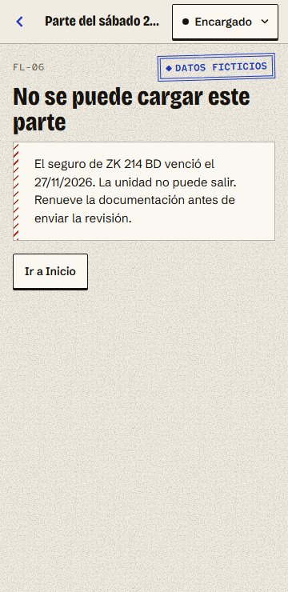

# Control de flota (demo)

## In English

A fleet-control demo: the home screen shows which vehicles are unavailable today and which documents expire soon, and drivers fill in a two-step daily report from their phone. It runs entirely in the browser (no server, no account, no external connections) and all data is fictional.

Stack: Vite 8, TypeScript 6 and Svelte 5 (no SvelteKit); the only production dependency is `svelte`. Rules live in plain TypeScript.

Live demo: <https://flota.matiasormeno.com.ar>

Run it locally (Node 24, npm 11): `npm install`, `npm run dev`, `npm test`.

Conceived, designed and directed by Matías Ariel Ormeño; built with AI.

The rest of this README and the code identifiers are in Spanish.

Demo web que responde, en la pantalla de inicio, a dos preguntas: **¿qué unidades no están disponibles hoy? y ¿qué documentos vencen pronto?** Además, el conductor completa su parte diario desde el celular, en dos pasos.

Funciona entera en el navegador: sin servidor, sin cuenta y sin conexiones externas. Los datos son ficticios. Parte del portafolio de Matías Ariel Ormeño.

**Demo en vivo:** <https://flota.matiasormeno.com.ar>

[](https://github.com/aslow01/demo-control-flota/actions/workflows/ci.yml)

![Inicio, perfil Encargado, a 1280 px. A la izquierda, el lateral oscuro con Inicio, Movilidades, Vencimientos y Operación diaria. En el centro, la regla de salida: un panel azul con «19 de 23» unidades disponibles hoy y cuatro lecturas (3 vencidos o faltantes, 9 que vencen en 30 días, 3 partes pendientes y 1 novedad crítica), y a la derecha una zona roja rayada con «4 No disponibles hoy». Debajo, las 23 llaves con la patente de cada unidad, la acción del día (ZK 214 BD no puede salir: seguro vencido) con los botones «Renovar» y «Probar como conductor», y las listas de no disponibles y vencimientos.](docs/img/inicio.png)

*Inicio (perfil Encargado, 1280 px): la regla de salida con las 19 unidades disponibles de 23 y las 4 que no, una llave por unidad, la acción del día y, más abajo, las listas que explican cada cifra.*


*Revisión antes de salir (360 px): el kilometraje se escribe (el campo arranca vacío y muestra el último registro como ayuda) y hay 14 puntos, con los críticos marcados; la barra dice cuántos datos faltan.*



*Seguro vencido (360 px): el parte no se puede cargar y la pantalla dice por qué. Las capturas son del 28/11/2026; las fechas de la demo son relativas al día en que se abre.*

## Cómo usarla

«Ver como» (el selector de perfil, en el lateral o arriba a la derecha en el celular) cambia entre **Encargado** (perfil de entrada) y **Conductor**. Es una perspectiva, no un control de acceso. **Reiniciar demo** vuelve al estado inicial.

1. **Encargado.** Abra la demo: Inicio muestra 4 unidades no disponibles hoy. Para ir directo al caso más claro, use la franja «Probar como conductor», bajo el subtítulo de Inicio: abre «Ver como» con un conductor cuyo parte está bloqueado ya elegido (paso 2). La franja se muestra solo mientras haya uno.
2. **Un seguro vencido bloquea el parte.** En «Ver como», elija **Conductor** y Tamara Olivera («Para probar: la unidad tiene la documentación vencida»): «Hoy» dice que el seguro de ZK 214 BD venció y que la unidad no puede salir, indica avisar al encargado y no ofrece «Empezar la revisión». Si se abre el parte de esa unidad, la pantalla dice «No se puede cargar este parte».
3. **Renovarlo.** Vuelva a Encargado y, en Vencimientos, pulse «Renovar» en el seguro de ZK 214 BD (también se llega desde un punto de la regla de Inicio): se abre un formulario con el número y el vencimiento del documento, ambos obligatorios. Al pulsar «Guardar renovación», el vencimiento desaparece de la lista y la unidad deja de figurar en «No disponibles hoy».
4. **Una conductora sin licencia.** En «Conductores que no pueden manejar hoy», dentro de «No disponibles hoy», figura Ivana Aguirre. Como Conductor, elíjala: en lugar de «Empezar la revisión», «Hoy» dice que no puede manejar hoy. Como Encargado, pulse «Renovar» en su fila y ya puede empezar.
5. **Una falla grave.** Como Andrés Echegaray (unidad ZYN 469, «unidad apta y sin parte hoy»), complete el kilometraje y los 14 puntos, con los frenos con novedad, y envíe. La unidad queda fuera de servicio y aparece en «No disponibles hoy».
6. **Una jornada normal.** Como Tamara Olivera, con el seguro al día, envíe una revisión sin novedades: «Hoy» muestra «En uso». Pulse «Cerrar el parte» y cargue kilometraje final y combustible: queda en solo lectura.

Pantallas: [`docs/pantallas.md`](docs/pantallas.md).

## Las reglas, en una línea cada una

- **Vencimientos:** cada documento se clasifica como vencido, vence en 7, 15 o 30 días, o vigente; el renovado reemplaza al anterior.
- **Parte en dos pasos:** revisión antes de salir y cierre al volver, con borrador guardado mientras se escribe. La revisión tiene 14 puntos, 7 críticos; cuatro son de minería: pértiga con banderola y baliza y alarma de retroceso (críticos), calzas y kit antiderrame y radio.
- **La licencia bloquea:** sin licencia vigente a la fecha del parte, el conductor no puede enviar la revisión.
- **La documentación de la unidad bloquea:** con el seguro u otro documento obligatorio vencido a la fecha del parte, la revisión no se envía; el borrador se conserva.
- **Cerrar antes:** con un parte anterior sin cerrar, no se inicia otra revisión.
- **Hasta mañana:** con una novedad crítica hoy, la unidad no sale ese día, aunque se repare.
- **Aptitud:** cada unidad figura como «Disponible» o «Bloqueada» (por documentos), «Fuera de servicio» o «De baja»; «No disponibles hoy» suma las bloqueadas y las fuera de servicio. Se calcula siempre; no se edita a mano.

Bordes de cada una: [`docs/limites.md`](docs/limites.md), sección 1. Casos de prueba: [`docs/diseno.md`](docs/diseno.md), sección 6.

**Códigos de regla.** Los comentarios del código citan reglas con una letra y un número (A1, P13, P19, T2…). La letra es el tema, según los apartados 6.1 a 6.10 de [`docs/diseno.md`](docs/diseno.md): T tiempo, V vencimientos, A aptitud, P parte, K kilometraje, N novedades, U unidades y conductores, H historial, D datos y persistencia, L licencia. Otros códigos (S3, E5, B2…) remiten a decisiones de diseño visual, etapas del plan o hallazgos de revisiones internas; están en `docs/diseno-ui.md`, `docs/plan.md` y `docs/registro.md`.

## Cómo correrla localmente

Requiere Node 24 y npm 11.

```
npm install
npm run dev          # servidor de desarrollo
npm run build        # compilación en dist/
npm run servir       # sirve dist/ con las mismas cabeceras de seguridad que se usarán al publicar
npm run peso         # mide el JavaScript con gzip y falla si la carga inicial pasa 97 KB o la primera visita 102 KB
npm run e2e          # pruebas de punta a punta (Playwright y axe) contra dist/ servido con las cabeceras reales
                     # (la primera vez: npx playwright install chromium; con otro puerto: E2E_PUERTO=4290 npm run e2e)
```

`npm run buscar` revisa que el repositorio no contenga lo prohibido (por ejemplo `{@html}`, el reloj del sistema fuera de `src/lib/estado/reloj.ts` o correos que no sean de ejemplo). La regla de nombres de terceros lee su lista de `scripts/prohibidos.local.json` (`{ "palabras": [...] }`), un archivo que no se versiona; si no existe, esa regla se omite con un aviso y las demás corren igual.

## Arquitectura

Las dependencias van en un solo sentido: `componentes` → `lib/estado` → `lib/dominio`. Una excepción: `lib/estado/instancia.ts` toma de `componentes/movimiento.ts` la transición entre pantallas.

- **`src/lib/dominio`:** TypeScript puro, sin Svelte, sin navegador y sin importar nada de las demás carpetas. Tiene las reglas (vencimientos, aptitud, parte, kilometraje, licencia, alertas), los textos y los comandos. Un comando es una función pura: recibe el estado, el comando y un contexto (reloj e identificadores inyectados) y devuelve los cambios y los eventos, o un error.
- **`src/lib/estado`:** une el dominio con la interfaz. Guarda el estado de la aplicación (`app.svelte.ts`), ejecuta los comandos de a uno y arma las vistas derivadas (Inicio, flota, ficha, parte), ya listas para dibujar y sin reglas nuevas.
- **`src/componentes`:** pantallas y piezas Svelte. Dibujan lo que arma `estado`; las reglas no se repiten acá.
- **`src/lib/persistencia`:** guarda el estado en IndexedDB (`indexeddb.ts`). Si no se puede abrir, usa un repositorio en memoria (`memoria.ts`) y avisa. El estado la usa a través de la interfaz `Repositorio`.
- **`src/lib/datos`:** el generador de la flota ficticia, con semilla fija.

## Cómo está hecha

- **Tecnología:** Vite 8, TypeScript 6 y Svelte 5, sin SvelteKit; la única dependencia de producción es `svelte`. Alternativas: [`docs/stack.md`](docs/stack.md).
- **Todo en el navegador:** datos en IndexedDB; si no se puede guardar, la demo sigue en memoria y avisa.
- **Reglas en TypeScript puro** (`src/lib/dominio`), probadas en tres zonas horarias.
- **Seguridad:** política de contenido estricta (`public/_headers`) con `connect-src 'none'`: la página no puede conectarse a ningún servidor ni cargar fuentes de otro sitio.
- **Tamaño:** en la carga inicial viajan solo el marco y Inicio: 93,9 KB de JavaScript comprimido con gzip (tope fijado: 95 KB), que es lo que baja quien vuelve el mismo día. Un visitante nuevo baja además el generador de la flota ficticia: 99,3 KB en la primera visita (tope fijado: 100 KB). Antes de dividir la carga eran 116,5 KB para todos; la mejora es mayor para quien vuelve (−19 %) que para quien entra por primera vez (−15 %, con un pedido más, en serie). En total, 165,8 KB repartidos en 19 trozos. Las demás pantallas y el código para escribir se descargan al abrir esa pantalla o al usarlo (carga diferida con `import()`; el parte, que escribe sin parar, baja los trozos de escritura al abrirse, y la ficha, al guardar; `npm run peso`, 27/11/2026). Las fuentes, aparte: unos 200 KB, que no cuentan como JavaScript.
- **Tipografías:** Bricolage Grotesque (títulos y cifras), Schibsted Grotesk (texto) y Red Hat Mono (patentes y números), alojadas en el repositorio, solo el subconjunto latino. Las tres son de código abierto con licencia SIL Open Font License 1.1; las licencias están en `src/estilos/fuentes/`.
- **Movimiento:** una transición corta entre pantallas (View Transitions), la patente que viaja de la lista a su ficha y una cifra que cuenta al abrir. Con «reducir movimiento» activado en el sistema no hay ninguna de las tres; en los navegadores sin View Transitions, y en Safari y los navegadores de iPhone, entra una animación CSS equivalente. Por qué no se usa View Transitions en WebKit: [`docs/limites.md`](docs/limites.md), sección 3.
- **Accesibilidad:** teclado, foco visible, modo claro y oscuro, desde 320 px; el color nunca va solo (cada estado lleva forma y texto). Los controles miden al menos 24 px, el mínimo de WCAG 2.2 (criterio 2.5.8): casi todos los botones y enlaces del celular, 44 px; en escritorio los botones chicos y las filas de las listas, 40 px, y los puntos de la regla de vencimientos, 26 px.

## Cómo se hizo

- **Matías Ariel Ormeño** concibió la demo, definió el problema (el parte en papel se daña, tarda y no deja evidencia), el alcance y las reglas, y dirigió y verificó el trabajo. Eligió entre las alternativas que se le propusieron; cada decisión figura con quién y cuándo en [`docs/diseno.md`](docs/diseno.md), sección 15, y [`docs/stack.md`](docs/stack.md), sección 9.
- **Desarrollo con IA:** el código, las pruebas y los documentos se desarrollaron con IA (Claude, de Anthropic) bajo su dirección; los commits llevan esa coautoría.
- **Método:** diseño primero, plan por pasos ([`docs/plan.md`](docs/plan.md)) y lógica con pruebas primero (TDD).
- **Los roles de `docs/`** («programador», «QA», «revisor», «auditor») son agentes de IA dirigidos por Matías, no personas. Las revisiones por etapa también las hicieron agentes de IA, no terceras personas.

## Cómo se verificó

Cifras medidas el 28/11/2026 en una computadora local:

| Comprobación | Comando | Resultado |
| --- | --- | --- |
| Pruebas automáticas | `npm test` | 2.344 pruebas en 91 archivos, todas pasan |
| Las mismas en tres zonas horarias | `npm run test:tz` | 2.344 pruebas en UTC, Asia/Tokio y América/Los Ángeles, todas pasan |
| Pruebas de punta a punta | `npm run e2e` | 84 pruebas (Chromium, contra `dist/` con la CSP real): cada pantalla sin errores de consola, sin violaciones de la CSP, sin violaciones de axe y sin desborde a 360 px; el generador de datos y los trozos (caído, colgado, lento, versión nueva); la escritura; y el servidor de las pruebas. Todas pasan |
| Tipos | `npm run check` | 0 errores y 0 avisos en 441 archivos |
| Contraste de la paleta | `npm run contraste` | 439 mediciones, 0 fallan, 24 justas |
| Búsqueda de lo prohibido | `npm run buscar` | Sin hallazgos (9 reglas y 312 archivos con el archivo local de términos; 8 reglas sin él) |
| Tamaño del JavaScript | `npm run peso` | Carga inicial 96.494 B (tope 97.000 B), primera visita 101.883 B (tope 102.000 B) y 175.367 B en total, con gzip |
| Dependencias | `npm audit` | 0 vulnerabilidades |

**Qué son esas 2.344 pruebas.** Unas 106 (106, en los 6 archivos `tests/textos*.test.ts`) fijan textos de la interfaz: mensajes de error, nombres de pantallas y frases con cifras; existen para que un cambio de redacción o de umbral no deje a la pantalla diciendo otra cosa que las reglas. Las otras 2.238 prueban reglas de dominio, comandos, estado, persistencia, el generador de datos y las vistas derivadas; algunas de ellas también comprueban una frase que se muestra, y esas no se separaron de las demás.

También se miró la demo en un navegador (Chromium con Playwright, contra la compilación servida con la política de contenido real), en claro y oscuro, a 360 y 1280 px: sin desbordes horizontales y sin mensajes en la consola. Eso, en claro y oscuro, no se puede reproducir con un comando; `npm run e2e` repite la parte automática en modo claro y, en oscuro, solo corre axe con un diálogo abierto y con el parte con errores, y mide el color de los objetos. La interfaz actual tuvo el 25/11/2026 una revisión de código, pruebas destructivas en Chromium y una auditoría de accesibilidad con mediciones propias (agentes de IA), y lo que encontraron se corrigió y se volvió a mirar. Desde el 27/11/2026 `npm run e2e` además corre axe-core en cada pantalla (1280 y 360 px) y comprueba qué se descarga y qué se ve cuando un trozo no baja. No se probó en un Safari real, ni en Firefox, ni con un lector de pantalla (detalle y lo que no se probó: [`docs/limites.md`](docs/limites.md), sección 3). La integración continua ([GitHub Actions](https://github.com/aslow01/demo-control-flota/actions/workflows/ci.yml), `.github/workflows/ci.yml`) corre en cada `push` y en cada solicitud de cambios del repositorio público: tipos, pruebas en tres zonas horarias, compilación, peso, pruebas de punta a punta (si fallan, sube el informe y las trazas), búsqueda de lo prohibido y `npm audit`. Las últimas ejecuciones sobre `main` que se consultaron el 26/11/2026 pasaron; las cifras de esta sección salen de la computadora local, no de ella.

## Límites conocidos

- **Sin login:** el perfil es una perspectiva; cualquiera puede «ser» el encargado.
- **Los datos viven en un solo navegador:** no se comparten y se pierden si se borran los datos del sitio.
- **Escribir y recargar en menos de 500 ms puede perder lo último:** el parte se guarda 500 ms después de la última tecla (y al salir del campo, al enviar o al irse de la pantalla).
- **Las pantallas se prueban de punta a punta solo en Chromium y en modo claro** (carga, consola, política de contenido, axe y desborde a 360 px; en oscuro, solo los dos casos de axe de arriba): el aspecto del modo oscuro, Firefox, Safari y las transiciones se verificaron a mano. El resto de las pruebas cubre reglas, generador, persistencia, estado y la cuenta de la cifra.
- **La habilitación de manejo interna del proyecto es opcional:** si un proyecto la pide, la demo no la exige para enviar la revisión. Se puede sumar después.
- **Las transiciones entre pantallas** solo se probaron en Chromium; en otros navegadores entra la animación CSS de reemplazo.

Límites menores: [`docs/limites.md`](docs/limites.md), sección 2.

## Datos ficticios

Todo es inventado y sale de una semilla fija (24 unidades, 24 conductores y 45 días de partes). De los conductores, 16 tienen unidad asignada y 8 son de relevo: cubren por turnos las unidades sin conductor. El CUIT de la empresa se muestra siempre con la palabra «ficticio». Las patentes empiezan con `Z` para alejarlas de las series en circulación; no se verificó que ninguna exista. Detalle: [`docs/limites.md`](docs/limites.md), sección 4.

## Origen

Iniciada el 18/11/2026 y escrita **desde cero** a partir de un enunciado propio. No usa código, datos ni capturas de terceros; solo reutiliza código propio y público del autor (la validación de CUIT de su demo [«Lector de facturas»](https://github.com/aslow01/demo-lector-facturas)).

## Documentos

Orden de lectura sugerido: este README, luego `pantallas.md` y `limites.md`. `diseno.md` y `registro.md` son bitácoras de trabajo (decisiones y pasos, con fecha), extensas y no hay que leerlas enteras: sirven para buscar el porqué de una regla o de un cambio, por ejemplo con su código (P13, A1…). `diseno-ui.md` es la especificación visual.

| Documento | Contenido |
| --- | --- |
| [`docs/pantallas.md`](docs/pantallas.md) | Qué permite cada pantalla. |
| [`docs/limites.md`](docs/limites.md) | Bordes de las reglas, límites menores y verificación. |
| [`docs/diseno.md`](docs/diseno.md) | Bitácora de diseño: problema, modelo de datos y reglas con su caso de prueba. |
| [`docs/diseno-ui.md`](docs/diseno-ui.md) | Diseño visual y accesibilidad. |
| [`docs/stack.md`](docs/stack.md) | Tecnología y criterio. |
| [`docs/plan.md`](docs/plan.md) | Pasos de implementación. |
| [`docs/registro.md`](docs/registro.md) | Bitácora: registro de cada paso. |

## Licencia

[MIT](LICENSE). Las tipografías conservan su propia licencia (SIL OFL 1.1), en `src/estilos/fuentes/`.
